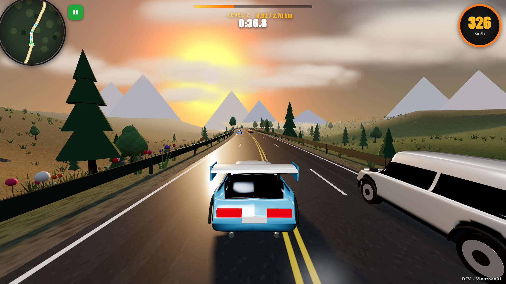

# Endless Roads

A browser-based 3D driving game. Weave through two-way traffic, stay on the road, and reach the finish distance to unlock faster, denser levels.

**[▶ Play Endless Roads](https://vinuthan01.github.io/endless-roads/)**

## Gameplay screenshot

  
   <em>Level 2 — weaving through traffic at 326 km/h.</em>

## Features

- Procedurally varied roads, hills, and scenery
- Two-way traffic with cars, vans, SUVs, and trucks
- Endless levels that increase in speed and traffic density
- Keyboard, mouse, and touch controls
- Optional automatic acceleration and two steering modes
- High and low graphics quality settings
- Pause, sound controls, vehicle color selection, and a minimap
- No installation or build step required

## Controls

| Action | Keyboard / mouse | Touch |
| --- | --- | --- |
| Accelerate | W or ↑ | ▲ |
| Brake | S, ↓, or Space | ■ |
| Steer | A / D or ← / → | ◀ / ▶, or slide on the left half of the screen |
| Look around | Move the mouse while driving | Drag on the screen |
| Pause / resume | Esc | Pause button |
| Change vehicle color | C | On screen button |
| Toggle sound | M | On screen button |

The start screen also lets you choose the starting level, steering mode, automatic acceleration, and graphics quality. On phones, turn the device to landscape for the best view.

## Run locally

Download or clone this repository, then open `index.html` in a modern browser. The game imports Three.js modules from jsDelivr, so an internet connection is needed when it loads.

## Tech and credits

The game uses HTML, CSS, JavaScript, and [Three.js](https://threejs.org/). Three.js is distributed under the MIT License. The game creates its sound effects and music with the Web Audio API. The gameplay screenshot shows Level 2 during a run.

## License

The project is available under the MIT License. See [`LICENSE`](LICENSE).

---

Made by [vinuthan01](https://github.com/vinuthan01).

